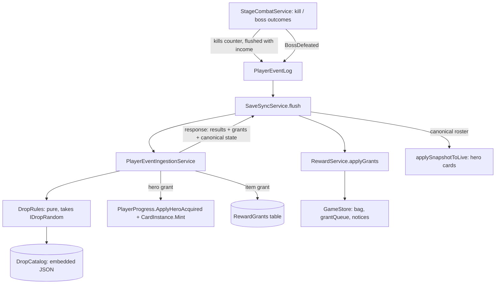

# Boss and Monster Drops Design

**Spec**: `.specs/features/boss-drops/spec.md`
**Status**: Approved (decided in heartbeat, 2026-10-08)

---

## Architecture Overview

The backend decides every drop (AD-001). The client only reports facts it already reports today
(`BossDefeated`) plus one new batched fact (`MonsterKillsBatch`), and displays what comes back.

### Decisions (all decided in heartbeat)

1. **One catalog, generated from client content.** The backend has no hero or item tables (stage-combat
   amendment). `npm run gen:drops` writes `shared/drop-catalog/drop-catalog.json` from `content/` and
   `CraftingRules`: heroes (`serverHeroId`, `heroType`, `minStage`), stage `favoredType`, item bands, slot of each
   item, affix ranges per slot, drop chances, `bagCapacity`. The backend embeds it as a resource;
   `gen:check` fails when it is stale (same pattern as `shared/openapi`). Content stays the single source.
2. **Hero grants reuse the HeroAcquired path.** A granted hero calls `ApplyHeroAcquired` and mints a `CardInstance`
   exactly like a client `HeroAcquired` event, so the canonical roster already carries it and the client's
   `applySnapshotToLive` adds the card. The grant list only drives the toast and "new vs. duplicate".
3. **Item grants are stored.** The backend has no inventory, so grants go to a new `RewardGrants` table
   (`GrantId`, `AccountId`, `SourceClientEventId`, `Kind`, `ItemId`, `AffixRollsJson`, `CreatedAtUtc`). The server
   mints `GrantId` (= the client `EquipmentInstance.instanceId`). A resent batch (response lost) returns the
   stored grants of already-recorded events, and the client applies grants idempotently by `GrantId`. This is what
   makes "the client never adds an item except from a backend grant" checkable.
4. **Kill rate by token bucket on server time.** `PlayerProgress.KillAllowance` + `KillAllowanceAtUtc`: allowance
   grows by `elapsed / MinKillIntervalMs` up to `KillBucketCap`. A `MonsterKillsBatch` of `count` kills is accepted
   only if `count <= allowance`; otherwise rejected whole with "Kill rate exceeds the possible maximum."
   `MinKillIntervalMs` = spawn delay + one step (400 ms) and `KillBucketCap` = offline credit cap in kills
   (12 h / 400 ms = 108 000); both live in `ProgressOptions`, kept equal to content by a `drop-rules` vector family
   (like `stage-rules`). Server time, never `occurredAtUtc`, so a forged timestamp gains nothing.
5. **Kills are counted, not listed.** `MonsterKillsBatch { stageNumber, count }`, `1 <= count <= 1000` per event
   (a larger counter is split into several events). Stage must be `<= furthest + 1` and not a boss stage. The
   normal-drop number of items is `Binomial(count, p)`, sampled by `count` Bernoulli draws (bounded by 1000).
6. **First defeat = `stage > HighestBossDefeated` before applying.** Boss defeats are monotone (a boss stage's clear
   needs its `BossDefeated`, and the next boss needs the earlier clear), and the column exists since stage-combat T3.
   Two devices cannot both win it: AD-006 allows one active session and the second event sees the new value.
7. **Type roll by renormalized weights.** Weights are 0.40 favored and 0.15 each other. When the picked type has
   no eligible hero, the draw repeats over types that do, with the same weights renormalized (DROP-01 AC 5).
8. **Bag full is a client queue.** Grants are never refused (spec edge case). `RewardService` adds an item to the bag
   when `bag.length < bagCapacity`, otherwise to `local.grantQueue`; selling or discarding an item drains the queue
   in order. While the queue is non-empty the notice "Bag full: sell items to make room" is shown once. The server
   does not track the bag (it has none); `bagCapacity` is only a client rule, default 100 (economy-tuning owns it).
9. **No VectorGen family for the rolls.** The client never rolls, so there is no second implementation to match.
   Rolls are tested by backend xUnit (fixed `IDropRandom` + statistical test). A `drop-rules` family covers only the
   numbers the client content and backend options must share (kill interval, bucket cap, chances).
10. **Client sim double.** `InProcessDrops` (dev/test only, in `app/dev-backend.ts`'s `ReplaceableBackend` family)
    grants deterministically from the sim seed so scenarios can assert drops; it is not a rule implementation and
    is never composed in production.

---

## Code Reuse Analysis

| Component | Location | How to Use |
| --- | --- | --- |
| `PlayerProgress.ApplyBossDefeated` / `HighestBossDefeated` | `Backend/src/.../Domain/Progress/PlayerProgress.cs` | Gate and first-vs-repeat detection |
| `ApplyHeroAcquired`, `CardInstance.Mint` | same, `Domain/Cards` | Hero grant path (decision 2) |
| `PlayerEventIngestionService.ApplyEventAsync` | `Backend/src/.../Application/Events` | New `MonsterKillsBatch` case; `BossDefeated` case gains the grant step |
| `ProgressOptions` | `Application/Progress/ProgressOptions.cs` | Kill interval, bucket cap, batch cap |
| `CraftingRules.affixesForSlot/affixRange` | `Client/src/domain/CraftingRules.ts` | Source of the catalog's affix ranges |
| `StageCombatService.flushIncome` | `Client/src/services/combat/StageCombatService.ts` | Kill counter flushes with the gold batch; `fastForward` counts offline kills the same way |
| `applySnapshotToLive` | `Client/src/services/sync/` | Brings granted hero cards in through canonical state |
| `EquipmentInventoryService`, `RosterService` | `Client/src/services/` | Bag add / bench add after a grant |
| `toPlayerMessage`, notices | `Client/src/services/` | Rejection correction text and reward toasts |
| `ReplaceableBackend` | `Client/src/app/dev-backend.ts` | Extended with the grant double |
| VectorGen `event-validation`, `stage-rules` | `Backend/tools/.../BackendFamilies.cs` | Extended with `MonsterKillsBatch` / `BossDefeated` drop cases; new `drop-rules` |

---

## Components

### DropCatalog + gen:drops (shared)
- **Purpose**: Hand the backend what only client content knows.
- **Location**: `Client/tools/gen-drops.ts` (new script, uses `loadContent` and `CraftingRules`), output `shared/drop-catalog/drop-catalog.json`, backend `DropCatalog` (Domain) + `EmbeddedDropCatalogLoader` (Infrastructure).
- **Interfaces**: `{ heroes: [{ heroId, serverHeroId, heroType, minStage }], stages: [{ stageNumber, favoredType, isBoss }], itemBands: [{ fromStage, itemIds }], items: [{ itemId, slot }], affixRanges: { <slot>: [{ affix, min, max }] }, normalDropChance, bossDropChance, bagCapacity }`.
- **Validation**: `validate:content` adds: every hero has `minStage >= 1`; every boss stage has at least one eligible hero in some type; item bands cover stage 1 and reference known items.

### DropRules (backend domain, pure)
- **Location**: `Backend/src/InfinityGrove.Backend.Domain/Drops/DropRules.cs`
- **Interfaces**:
  - `IDropRandom { double NextDouble(); }` (production: `RandomNumberGenerator`; tests: scripted).
  - `RollHero(DropCatalog, int bossStage, IDropRandom) -> Guid` (type by weights, renormalized, then uniform eligible hero)
  - `HeroDropChance(bool firstDefeat) -> double` (1.0 / 0.01)
  - `RollItem(DropCatalog, int stage, IDropRandom) -> RolledItem { ItemId, AffixRolls }` (template uniform in the band; each affix of the slot uniform integer in `[min, max]`)
  - `CountNormalDrops(int kills, double p, IDropRandom) -> int`

### Ingestion changes (backend application)
- `PlayerEventType.MonsterKillsBatch = 6`; payload `MonsterKillsBatchPayload(int StageNumber, int Count)`.
- `ApplyMonsterKillsBatch`: validates stage window, boss stage, count bounds and the bucket (spec DROP-04 AC 2), then rolls items.
- `BossDefeated`: after `ApplyBossDefeated`, computes `firstDefeat`, rolls hero (always / 1%) and independently an item (25%).
- Rejections add to `EventRejections`: kill rate ("Kill rate exceeds the possible maximum.") and the existing boss-order message stays.
- `EventIngestionResult` gains `Grants`; `IngestBatchResult` unchanged otherwise. Grants of an already-recorded event are loaded from `RewardGrants` by `SourceClientEventId`.
- `RewardGrantDto { grantId, kind: 'Hero' | 'Item', heroDefinitionId?, isNewHero?, itemId?, affixRolls?, sourceClientEventId }`.

### RewardService (client services)
- **Location**: `Client/src/services/rewards/RewardService.ts`
- **Interfaces**: `applyGrants(grants: RewardGrant[]): void` (idempotent by `grantId`; remembers the last 500 ids in `local.appliedGrantIds`).
- **Behavior**: Hero grant → toast "New hero: <name>!" or "Duplicate: <name> +1" (unknown content id → "New hero (update the game to see it)" + log). Item grant → bag at +0 or `grantQueue` (decision 8) + toast "Item: <name>".
- **Layer**: services only; never called except from `SaveSyncService` (lint rule below).

### Kill counting (client services)
- `StageCombatService` keeps `pendingKills: { stageNumber, count }` next to pending gold; `flushIncome` appends `MonsterKillsBatch` events (split at 1000). `fastForward` adds its farming kills the same way. A stage change flushes first so a batch never mixes stages.

### Lint rule
- dependency-cruiser/ESLint: only `services/rewards/RewardService.ts` may call the bag add and `RosterService.addHeroCard` with a granted payload from the sync path; a negative fixture shows a presentation or other service importing it fails (like the AD-22 affix rule). The starter hero path (`SaveSyncService` new game) stays the documented exception.

### Presentation
- Toasts through the existing notice list; no new screen. `game.grantQueue` node in `describe()` shows the queue length so e2e can assert the bag-full state.

---

## Data Models

### Backend
- `PlayerProgress`: `KillAllowance` (double), `KillAllowanceAtUtc` (DateTimeOffset?). Migration `AddKillAllowance`.
- `RewardGrant` entity + table `RewardGrants` (decision 3), migration `AddRewardGrants`, index on `(AccountId, SourceClientEventId)`.
- `ProgressOptions`: `MinKillIntervalMs = 400`, `KillBucketCap = 108000`, `MaxKillsPerEvent = 1000`.

### Client
- `content/heroes/*.json`: new optional `minStage` (default 1); six placeholder heroes get 1/1/1/3/6/9 so the pool grows across the 10 placeholder stages.
- `content/economy/drops.json`: `{ normalChance, bossChance, bagCapacity, itemBands: [{ fromStage, itemIds }] }`.
- Save `formatVersion` 3: `local.grantQueue: EquipmentInstance[]`, `local.appliedGrantIds: string[]`; `local.combat.pendingKills` is runtime only (flushed on save, like pending gold).
- API: `shared/openapi` re-exported (new event type, `grants` on results); `gen:api` regenerated.

---

## Error Handling Strategy

| Scenario | Handling | User impact |
| --- | --- | --- |
| Kill batch beyond allowance | Whole event rejected, not partially accepted | Correction notice with the reason |
| Boss beyond furthest + 1 | Existing rule, message "Cannot defeat boss of stage <n> before stage <m>." | Correction notice |
| Offline / unsynced | No grant, events stay pending | Toast "Rewards pending sync" once per session |
| Response lost after commit | Resent batch returns stored grants | Rewards still appear, once |
| Hero id unknown to client content | Card kept in state, id logged | "New hero (update the game to see it)" |
| Catalog stale vs content | `gen:check` fails the gate | Developer regenerates |
| Empty hero pool for every type | Cannot happen (validate-content rule); backend throws a 500-class invariant error and logs | None expected |

---

## Risks & Concerns

- **Bucket vs. offline credit**: the bucket cap equals the offline cap in kills; if economy-tuning changes the spawn delay or `offlineAccrualCapHours`, the options and the `drop-rules` vectors must change together (the vector family exists to catch it).
- **Client-side bag is still editable**: a modified client can edit its save to add items. Full protection needs a server inventory, which is out of scope here (noted for the Market work). This feature guarantees the *drop path*, not save-file tampering; stated in the spec's DROP-04 wording check at Verify.
- **Statistical test flakiness**: use a fixed seed for the 100 000-roll test (±1 point), not true randomness.
- **Grants table growth**: one row per item grant; at 3% and a rate cap this stays bounded per account; cleanup policy deferred to the Market/inventory work.
- **Unity parity**: this is new behavior (design freeze S6 allows it as a game-PRD feature); no Unity reference.

---

## Tech Decisions

| Decision | Choice | Rationale |
| --- | --- | --- |
| Source of catalog | Generated from client content | No duplicated data; one place to add heroes (RFR-12) |
| Hero grant mechanism | Existing `HeroAcquired` backend path | Roster, CardInstance minting and reconciliation already work |
| Item persistence | `RewardGrants` table, client applies by id | Idempotent resend, auditable, no inventory yet |
| Kill validation | Token bucket on server time | Offline catch-up allowed, forged timestamps useless |
| Rolls shared with client | None | Client never rolls, so no vector family for rolls |
| Bag full | Client queue, grants never refused | Matches the spec edge case, no server bag needed |
