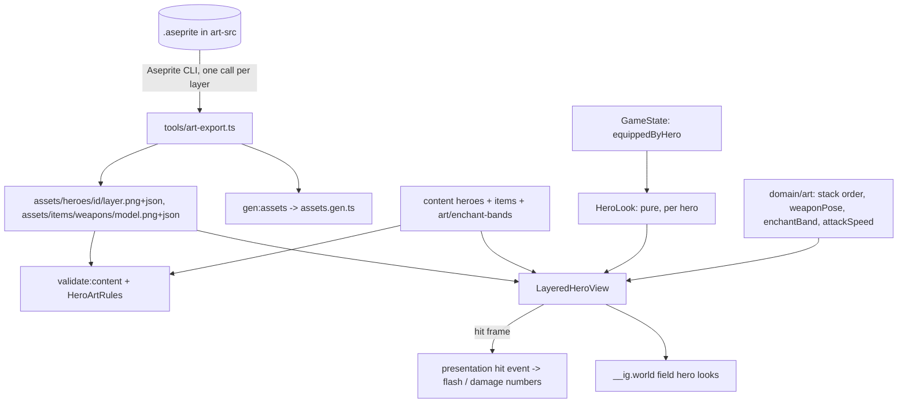

# Hero Art Pipeline Design

**Spec**: `.specs/features/hero-art-pipeline/spec.md`
**Status**: Approved (decided in heartbeat, 2026-10-07)

---

## Architecture Overview

Three independent stages, joined only by files on disk:

1. **Export** (developer machine, needs Aseprite): `tools/art-export.ts` turns `art-src/heroes/<heroId>/<heroId>.aseprite`
   and `art-src/items/weapons/<modelId>.aseprite` into checked-in PNG + Aseprite-JSON pairs under `assets/`.
2. **Validate** (CI, no Aseprite): a pure rule set (`services/content/HeroArtRules.ts`) reads those JSON files
   plus hero/item content and reports every guide rule with file and field (RNFR-11).
3. **Compose** (runtime): pure rules in `domain/art/` (layer order, weapon placement math, enchant band,
   attack playback speed) and one Phaser view, `LayeredHeroView`, that owns the display objects.



Equipment state is read, never written: this feature adds no service command and no `PlayerEvent`
(AD-5 is untouched), and no I/O port (export is a developer tool outside `src/`).

---

## Code Reuse Analysis

| Component | Location | How to Use |
| --- | --- | --- |
| `gen:assets` aseprite detection | `tools/gen-assets.ts` | PNG with sibling JSON becomes `Assets.aseprite[key]`; layers and weapon models need no change there |
| `FieldHeroView` | `src/presentation/scenes/FieldHeroView.ts` | Keeps the portrait and legacy paths; delegates to `LayeredHeroView` when `art.mode === 'layered'` |
| `art:slice` PNG helpers | `tools/lib/png.ts` | Test fixtures only (the golden test-hero is generated by code, see Test Strategy) |
| `loadContent` + zod schemas | `src/services/content/` | New optional fields and the `art` content kind; cross-checks added to the loader |
| `phaserColor`, tokens | `src/presentation/theme/tokens.ts` | Default neutral armor tint (`inkDim`) |
| `equippedByHero` | `src/services/state/types.ts:56` | Source of the look: per hero, per slot instance |
| `world()` dev hook | `src/app/dev-hooks.ts:100` | `WorldScene.fieldState()` gains per-hero look fields |
| Krell animation path | `FieldHeroView` variants | Becomes `art: "legacy"`, unchanged behavior |

### Integration Points

| System | Integration Method |
| --- | --- |
| Equipment screen / roster | None: they already move instances between bag and `equippedByHero`; the view reacts to the store |
| equipment-enchant (later) | Owns `EquipmentInstance.enchantLevel`; this feature only reads it through `enchantLevelOf(instance)` (0 when absent) |
| stage-combat | Supplies attack cadence (`attackCount`) and `fighting` flag; the view maps them to tags `attack`/`idle`/`hurt`/`ko` |
| Backend | None: art is presentation only |

---

## Components

### Aseprite runner (tool)

- **Purpose**: Locate and run the Aseprite CLI; no export policy.
- **Location**: `tools/lib/aseprite.ts`
- **Interfaces**: `findAseprite(env, exists): string | AsepriteNotFound` (order: `ASEPRITE_PATH`, `aseprite` on PATH, the Steam path; the error lists the three tried), `exportLayer(exe, file, layer, outBase): Promise<void>`.
- **Command**: `--batch <file> --layer <name> --sheet-type packed --trim --format json-array --list-tags --list-slices --sheet <out>.png --data <out>.json` (no `--merge-duplicates`: frame count and order must stay identical across layers).

### art:export (tool)

- **Purpose**: ART-01, ART-02, ART-11 (export side).
- **Location**: `tools/art-export.ts` (npm script `art:export`)
- **Flow**: derive `heroId` from the folder, require `content/heroes/<heroId>.json`; list layers once (`--list-layers`); warn on unknown names; skip `ref*`/`guide*`; export each exportable layer into a temp dir; **only when every call succeeded** move the files into `assets/heroes/<heroId>/` (previous files stay untouched on failure); normalize JSON (`meta.app`/`version`/`image` path, stable key order, `\n` endings) so a second export is byte-identical; copy `portrait.png`; run `gen:assets`; print keys. Weapon models take the same path with a single implicit layer and no content lookup.
- **Reuses**: `tools/lib/aseprite.ts`, `tools/gen-assets.ts` (spawned as a child process).

### Sheet reader + hero art rules (services/content)

- **Purpose**: ART-03, ART-04, ART-11 (weapon size). Pure, no I/O: input is parsed JSON objects.
- **Location**: `src/services/content/AsepriteSheet.ts` (zod schema for the subset used: `frames[].{duration, sourceSize, spriteSourceSize, frame}`, `meta.frameTags[]`, `meta.slices[].{name, data, keys[].{frame, bounds}}`; returns `SheetInfo { frameCount, durations[], canvas, tags, slices }`), `src/services/content/HeroArtRules.ts`.
- **Interfaces**: `validateHeroArt(heroes, items, sheets: ReadonlyMap<assetKey, unknown>, assetKeys): string[]` (problem strings in the loader's `file: field message` form).
- **Rules** (one function each, negative fixtures one per rule): required tags (AC 1), `attack` ≤ 600 ms (sum of its frame durations), canvas 512 × 512 via `sourceSize`, equal frame count and per-frame duration across layers (names the first differing layer and frame), `grip`/`tip` keys for every frame, `body` present, weapon model has `grip`/`tip` and ≤ 256 × 256, `visual.weaponModel` resolves to `items/weapons/<id>`.
- **Addition (decided in heartbeat)**: each layer PNG must be ≤ 4096 × 4096 (VRAM bound, see Risks); spec gets this as ART-03 AC 7.

### Content wiring

- `validate:content` reads each layered hero's sheet JSON from `assets/` (via `FsContentSource`-style helper in `platform/node`) and passes them to `loadContent`, which calls `validateHeroArt`. Browser/Electron loading keeps `loadContent(entries, assetKeys)` unchanged because art rules are a build-time check, not a runtime one; runtime only handles a failed load (ART-09 AC 3).

### Layout rules (domain)

- **Purpose**: Everything about composition that is arithmetic, so it is unit-testable without Phaser.
- **Location**: `src/domain/art/HeroLook.ts`, `WeaponPose.ts`, `EnchantBand.ts`, `AttackSpeed.ts`.
- **Interfaces**:
  - `LAYER_ORDER`, `layerOrder(weaponBehind: boolean): readonly LayerSlot[]` - `body, armor_boots, armor_gloves, armor_chest, weapon, fx`; with `behind` the weapon moves under `body` (ART-05).
  - `heroLook(equipped, items, art): HeroLook { weaponModel | null, tint: Record<'Chest'|'Gloves'|'Boots', number>, enchantLevel }` - slot `Chest/Gloves/Boots` → `armor_chest/gloves/boots`; missing `visual.color` or empty slot → `art.neutral` (default passed in by presentation, `inkDim`).
  - `weaponPose(heroGrip, heroTip, weaponGrip, weaponTip): { x, y, rotation }` - position at hero `grip`, rotation = `atan2(tip - grip) - atan2(weaponTip - weaponGrip)`; degenerate (`tip == grip`) returns rotation 0.
  - `enchantBand(level, bands): EnchantBand | null`.
  - `attackSpeed(tagDurationMs, intervalMs): number` - `max(1, duration / interval)`.
- **Dependencies**: domain types only.

### LayeredHeroView (presentation)

- **Purpose**: ART-05, ART-06, ART-08 (+ ART-10 later).
- **Location**: `src/presentation/scenes/LayeredHeroView.ts`
- **Structure**: one Container per hero holding one Sprite per exported layer (`createFromAseprite` per layer; animation keys are namespaced `<heroId>/<layer>:<tag>` so five heroes never clash) plus a weapon Image and an optional fx Graphics/particle emitter. Max 8 display objects per hero (body, 3 armor, fx, weapon, glow, aura), at most 5 heroes (RNFR-4 budget).
- **Playback**: `play(tag, speed)` starts the same tag on all layers in the same update; layers are advanced from the **body** sprite's frame: on `ANIMATION_UPDATE` of body every other layer is `setFrame`d to the same index (guarantees ART-05 AC 1 even if timers drift) and the weapon is re-posed from the `grip`/`tip` keys of that frame (`behind` = the `grip_behind` slice has a key for that frame, see Risks).
- **Tint**: `sprite.setTint(color)` (multiply mode) on each armor layer; re-applied from `HeroLook` when the equipped instance changes (next rendered frame, ART-06 AC 8).
- **Enchant**: band effects built from content (glow = additive tinted copy of the weapon image, aura = additive tinted copy of `body`, particles via the existing effect schema); skipped when `app.config.effects === 'off'` (test and low-spec).
- **Hit event**: when body shows the first frame of tag `hit` (found in `meta.frameTags`), emits `hit` through a typed `Phaser.Events.EventEmitter` the scene already owns; consumers (flash, damage numbers) subscribe in stage-combat follow-ups.
- **Failure**: any missing texture/animation → `LayeredHeroView.create` returns null; `FieldHeroView` falls back to the portrait and logs `hero-art: <heroId> failed to load` once (ART-09 AC 3).
- **Dependencies**: `Assets`, `domain/art`, `services/content/AsepriteSheet` (to read slices from the cached JSON), Phaser.

### FieldHeroView (changed)

- Chooses by `hero.art?.mode`: `layered` → `LayeredHeroView`; `legacy` → existing variant path; none → portrait. Exposes `look()` for the dev hook. Tag mapping: fighting/idle → `idle`; attack cadence → `attack` with `attackSpeed`; knocked-out → `ko` (held on last frame); boss damage to the hero → `hurt` then back.

### Dev hook

- `__ig.world().field[]` entry per hero: `{ heroId, art, tag, weaponModel, tint: {armor_chest, armor_gloves, armor_boots}, enchantBand }` (tint as `#rrggbb`, empty slots show the neutral color).

---

## Data Models

### Content (zod, strict)

```typescript
// content/heroes/<id>.json (optional)
art?: { mode: 'layered' | 'legacy'; neutral?: HexColor }   // absent = portrait fallback
// content/items/<id>.json (optional)
visual?: { weaponModel?: string; color?: HexColor; colorDark?: HexColor }   // weaponModel only on Weapon slot items; color only on Chest/Gloves/Boots; colorDark = P3
type HexColor = string // /^#[0-9a-fA-F]{6}$/
// content/art/enchant-bands.json (new kind "art", id field `artId`, one file)
{ artId: 'enchant-bands', bands: Array<{ minLevel: number; glow: boolean; aura: boolean; particles?: effectId }> } // sorted, non-overlapping, minLevel >= 1
```

Domain `HeroData` and `EquipmentItemData` gain the same optional fields (their `satisfies` checks keep schema and type in step). Krell's content gets `"art": { "mode": "legacy" }`. Weapon item `visual.weaponModel` is checked against `Assets.aseprite['items/weapons/<id>']`.

### Asset layout

```
art-src/heroes/<heroId>/<heroId>.aseprite  (+ portrait.png | portrait.aseprite)
art-src/items/weapons/<modelId>.aseprite
assets/heroes/<heroId>/{body,armor_chest,armor_gloves,armor_boots,fx}.png|json   -> keys heroes/<heroId>/<layer>
assets/heroes/<heroId>/portrait.png                                              -> image key heroes/<heroId>/portrait
assets/items/weapons/<modelId>.png|json                                          -> keys items/weapons/<modelId>
```

---

## Error Handling Strategy

| Error Scenario | Handling | User Impact |
| --- | --- | --- |
| Aseprite not found | Exit 1 listing the three locations and `ASEPRITE_PATH` | Developer only |
| Aseprite fails or writes nothing | Exit 1 with its output; temp dir discarded, `assets/` untouched | Developer only |
| Unknown layer name | Warning naming it; not exported | Developer only |
| Guide rule broken in committed sheets | `validate:content` exit 1, message names hero/file/frame | Build fails in CI |
| Layered hero sheet missing at runtime | Portrait fallback + one log line with the hero id | Hero shown as a still |
| Hero has no weapon / empty armor slot | No weapon object; neutral tint | Plain look |
| `visual.weaponModel` unknown at runtime (content drift) | No weapon drawn, logged once per model | Plain look |
| Effects off (tests, low-spec) | Enchant effects not created | None |

---

## Risks & Concerns

| Concern | Location | Impact | Mitigation |
| --- | --- | --- | --- |
| 512 × 512 × ~28 frames × 5 layers × 5 heroes is large (untrimmed sheet 4096 × 2048 × 5 layers ≈ 168 MB/hero) | export command | Steam Deck VRAM and load time | `--trim` + packed sheets (Phaser reads `spriteSourceSize`); rule: every layer PNG ≤ 4096 × 4096; measure in soak before the first real hero ships |
| Slice user data is per slice, not per frame key, in Aseprite | guide §5.2 (`behind` per frame) | Cannot mark single frames as `behind` | Decision: the artist uses **one extra slice named `grip_behind`** with a key only on the `behind` frames (key bounds are present, user data not needed); weapon is behind body in exactly the frames where that slice has a key. Guide §5.2/§9 and spec ART-05 AC 3 are updated in the first task |
| Aseprite output differs by version (`meta.app`, `version`, paths) | export determinism (ART-02 AC 4) | Churn in diffs | Normalize meta before writing; test with a recorded Aseprite JSON fixture, no real Aseprite in CI |
| `createFromAseprite` animation keys are global | five heroes share tag names | Wrong animation on a layer | Namespace keys per hero+layer by building animations from the parsed tags instead of the default keys |
| `enchantLevel` does not exist on `EquipmentInstance` yet | `src/domain/EquipmentInstance.ts` | Bands cannot be driven by real data | `enchantLevelOf` returns 0 when absent; e2e fixture items carry `enchantLevel`; equipment-enchant adds the field and the backend rule (AD-001) |
| Real hero art does not exist | hero content | e2e needs a layered hero | Committed code-generated `test-hero` (flat colored layers, valid slices) used by unit/e2e; never shipped in the manifest of the release build (excluded by a `test-` prefix rule in `gen:assets` for production mode) |

---

## Test Strategy

| Layer | Tests |
| --- | --- |
| tools | `art-export` against a stub Aseprite executable (a script printing recorded JSON/PNG): determinism (twice, diff), missing-Aseprite message, failure leaves `assets/` unchanged, unknown-layer warning, missing hero content |
| services/content | One negative fixture per rule (ART-03/04/11), plus the accepting case; schema tests for `art`, `visual`, `enchant-bands` |
| domain/art | `layerOrder`, `heroLook` (empty slot, missing color), `weaponPose` (angles, degenerate), `enchantBand` boundaries (+6/+7/+9/+10/+14/+15), `attackSpeed` |
| scenarios | `scenarios/p15-hero-look.json`: equip/unequip through services with `expect` on equipped state (look derivation is pure; covered by `heroLook` unit tests on the same state) |
| e2e | `?scene=game&save=layered-squad`: assert `__ig.world()` for layered, legacy and art-less heroes; equip/unequip via the Equipment screen with gamepad; enchant band on a fixture item; effects off; failed sheet load falls back. Screenshots (not asserted) for review |
| backend | None: nothing the backend must accept or reject changes (stated in the tasks) |

---

## Tech Decisions

| Decision | Choice | Rationale |
| --- | --- | --- |
| Where art rules live | Pure `services/content/HeroArtRules.ts` fed with parsed JSON | CI has no Aseprite and no browser; same pattern as content cross-checks |
| Tint | Phaser multiply tint per armor layer | Keeps cel shading (AD-005), one call, no shader |
| Layer synchronization | Body drives frame index; other layers `setFrame` | Exact ART-05 AC 1 regardless of timer drift |
| `behind` marker | Extra `grip_behind` slice present only on those frames | Aseprite user data is per slice, not per frame |
| Enchant data owner | equipment-enchant owns the level; this feature reads it via `enchantLevelOf` | Avoids changing the persisted shape before its design |
| Test hero | Generated by code, committed, excluded from release manifest | No dependency on Aseprite or unfinished art |
