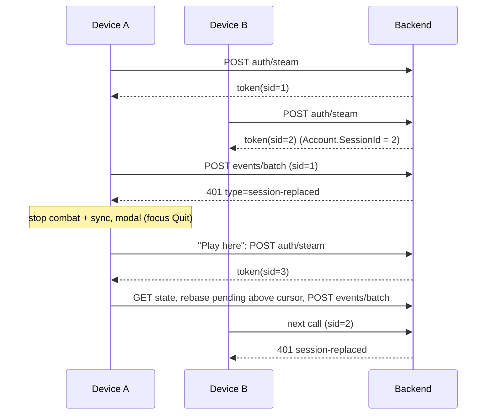

# Single Active Session Design

**Spec**: `.specs/features/single-active-session/spec.md`
**Status**: Approved (decided in heartbeat, 2026-10-08)

---

## Architecture Overview

The backend owns "which session is current": `Account.SessionId` is replaced on every Steam login and
the JWT carries it as claim `sid`. A thin JwtBearer hook compares the claim with the account's current
id on every request. The client treats a `session-replaced` 401 as a terminal state for syncing (no
silent re-login) until the player chooses "Play here". Event numbering is repaired on the client by
rebasing pending events above the server cursor whenever canonical state is adopted; the backend
refuses to swallow stale unknown events.



AD-5 holds: no new `PlayerEvent`; session handling is transport state, not game state.

---

## Code Reuse Analysis

| Component | Location | How to Use |
| --- | --- | --- |
| `Account.RecordLogin` | `Backend/src/InfinityGrove.Backend.Domain/Accounts/Account.cs` | Replaced by `StartSession(nowUtc)` (sets `SessionId` and `LastLoginAtUtc`) |
| `SteamAuthenticationService` | `Backend/.../Application/Auth/` | Calls `StartSession` for new and existing accounts before `CreateToken` |
| `JwtSessionTokenService` | `Backend/.../Infrastructure/Auth/` | Adds claim `sid` from `account.SessionId` |
| JwtBearer setup | `Backend/.../Api/Program.cs:22` | Adds `Events.OnTokenValidated` / `OnChallenge` |
| `PlayerEventIngestionService` | `Backend/.../Application/Events/` | Stale branch (`SequenceNumber <= LastAppliedSequence`, unknown id) becomes a rejection |
| `PlayerEventLog.seedSequence` | `Client/src/services/events/PlayerEventLog.ts` | Gains `rebase`; `applyCanonical` calls it |
| `BackendApiClient.call` | `Client/src/services/backend/BackendApiClient.ts:85` | Parses the 401 body for the problem type |
| `SaveSyncService.syncNow/connect` | `Client/src/services/sync/SaveSyncService.ts` | Gating on the replaced state; `playHere()` |
| `TickDriver.advance` | `Client/src/services/tick/TickDriver.ts` | Skips stepping while replaced |
| `onBeforeQuit` bridge | `Client/desktop/bridge.ts` | New `app.quit()` next to it (allowlist updated) |
| `Notice` / `App.tsx` | `Client/src/presentation/ui/` | Pattern for DOM nodes in `describe()`; the modal is a new overlay in the same tree |

---

## Components

### Backend: session identity

- **Domain**: `Account.SessionId : Guid` (new column `SessionId uuid not null`, migration `AddAccountSessionId`, existing rows get `gen_random_uuid()`-equivalent via `Guid.NewGuid()` in the migration SQL default). `StartSession(now)` sets `SessionId = Guid.NewGuid()`. `CreateForSteamId` starts a session.
- **Token**: claim `sid` = `SessionId`. `ISessionTokenService.CreateToken(account)` unchanged in signature.
- **Validation port**: `ISessionValidator.IsCurrentAsync(accountId, sessionId, ct)` in `Application/Auth/`, backed by `IAccountRepository` (one indexed read per request; no cache, a takeover must bite immediately). Unit-testable without ASP.NET.
- **Hook**: in `Program.cs`, `OnTokenValidated` reads `sub` + `sid`; a token without `sid` (issued before this feature) or a non-matching `sid` fails the request. When the token is well-formed but the id differs, `HttpContext.Items["session-replaced"] = true`; `OnChallenge` then writes `401` `application/problem+json` with `type: "session-replaced"`, `title: "Session replaced."`, `detail: "Infinity Grove was opened on another device."`. A token with no `sid` or an expired token stays a plain 401 (no type), so the client re-logs in silently as today.
- **Simultaneous logins** (SESSION-04): each login overwrites `SessionId` in its own transaction; the last committed write wins and the other token is invalid on its first call. No locking needed.

### Backend: stale events

In `PlayerEventIngestionService`, the branch `incoming.SequenceNumber <= progress.LastAppliedSequence` (clientEventId unknown) returns `Rejected` with reason `Stale sequence; resend after login.` (constant `EventRejections.StaleSequence`). It is **not** persisted and does not move the cursor (the client will resend the same `clientEventId` renumbered). Known ids keep returning their stored verdict.

### Client: event rebase

`PlayerEventLog.rebase(log, cursor)`: if the lowest pending sequence is `<= cursor`, renumber pending events consecutively from `cursor + 1` in their current order and set `nextSequenceNumber` to one past the last; otherwise return the log unchanged. `SaveSyncService.applyCanonical` calls it after `seedSequence`, so it runs on login pull, after each batch and after a stale rejection. `clientEventId` never changes (a lost response is still deduplicated by the backend).

`flush()` treats a verdict whose reason equals `STALE_SEQUENCE_REASON` (shared string constant, matched exactly; the spec fixes the text) as "keep pending, no correction notice": the event stays in the log and `applyCanonical` rebases it for the next sync (SESSION-03 AC 3).

### Client: replaced state

- `BackendApi` gains `readonly sessionReplaced: boolean`. `BackendApiClient.call` on HTTP 401 parses the body; `type === 'session-replaced'` sets it. `authenticateWithSteam` success clears it.
- `GameState.sync` gains `sessionReplaced: boolean` (transient, not persisted). `SaveSyncService` sets it after any call that left `backend.sessionReplaced` true.
- While set: `syncNow` and `connect` neither authenticate nor flush (they still `persist()` locally); `TickDriver.advance` returns without stepping (combat and income stop; elapsed time is not credited because the device clock is not advanced into `fastForward`).
- `SaveSyncService.playHere()`: authenticate; on success clear the flag, `getState`, `applyCanonical` (rebase), `flush`, `persist`. On failure keep the flag (modal stays; the player can retry or quit).
- `SaveSyncService.quitGame()`: `persistLocalAndCloud()` then `AppLifecycle.quit()`.

### New port: `AppLifecycle`

`services/ports.ts`: `interface AppLifecycle { quit(): void }`. `platform/electron` calls `bridge.app.quit()` (new IPC `ig:app:quit` -> `app.quit()` in `desktop/main`); `platform/browser` calls `window.close()` (best effort); `platform/node` records the call for tests. `desktop/bridge.ts` allowlist gains `app.quit`; the shell smoke test's exact allowlist is updated with it.

### Presentation: modal

`SessionReplacedModal` (Preact overlay, shown when `sync.sessionReplaced`): text "Infinity Grove was opened on another device.", buttons `session.quit` (initial focus) and `session.playHere`. Both are `describe()` nodes, reachable by gamepad (A activates, left/right moves focus); the modal traps focus while open and ignores the screen underneath. Presentation reads the flag from the `ReadonlyStore` and calls two callbacks wired in `compose` (`sync.playHere`, `sync.quitGame`).

---

## Data Models

```ts
// GameState.sync (services/state/types.ts)
sessionReplaced: boolean;            // transient

// services/ports.ts
interface AppLifecycle { quit(): void }
```

```csharp
// Account
public Guid SessionId { get; private set; }
public void StartSession(DateTimeOffset nowUtc);   // new Guid, LastLoginAtUtc = nowUtc
```

Wire: `401 application/problem+json { "type": "session-replaced", "title": "Session replaced.", ... }`. Rejected verdict: `{ status: "Rejected", rejectionReason: "Stale sequence; resend after login." }`. `openapi.json` does not change shape (the 401 is not modeled), so `gen:api` is untouched.

---

## Error Handling

| Scenario | Handling |
| --- | --- |
| Token expired, same device | Plain 401: client clears the token and re-logs in on the next sync (unchanged) |
| Replaced device offline | No call, no modal; the first sync attempt after reconnect gets the 401 and shows the modal |
| "Play here" while offline | Authenticate fails; modal stays, Quit still works |
| Pending events after takeover | Kept in the log (local save too); rebased at the next login/canonical adoption; game-rule rejections still produce correction notices |
| Old token without `sid` | Plain 401, silent re-login |

---

## Tech Decisions (decided in heartbeat)

| Decision | Choice | Rationale |
| --- | --- | --- |
| Where the session lives | Column on `Account`, claim `sid` | Single row per account, immediate takeover, no new table |
| Per-request check | DB read in `OnTokenValidated` | Spec requires disconnect within one sync interval; one indexed read per sync is cheap |
| Marking the 401 | `OnChallenge` + `HttpContext.Items` flag | JwtBearer has no first-class "custom failure body" |
| Stale rejection not persisted | No `PlayerEvent` row, cursor unchanged | The same `clientEventId` must be accepted once renumbered |
| Rebase placement | Inside `applyCanonical` | One code path covers login, post-batch and post-stale |
| Matching the stale reason | Exact string constant on both sides | Spec fixes the text; avoids an openapi change. A backend test and a client test pin the same literal |
| Quit | New `AppLifecycle` port | Layer rule: new I/O means a port first |

---

## Test Strategy

Backend (xUnit, `Backend/tests/InfinityGrove.Backend.Tests`): `Account.StartSession` changes id; auth service issues a token whose `sid` equals the account's session and a second login changes it; `SessionValidator` accepts current, rejects replaced and missing account; ingestion stale unknown id is `Rejected` with the exact reason, not persisted, cursor unchanged, known id still returns prior verdict, a fresh sequence is still applied. Client (vitest): `PlayerEventLog.rebase` (no-op, renumber, order, ids kept), `BackendApiClient` 401 typed vs plain over a fake `HttpPort`, `SaveSyncService` replaced gating / `playHere` / stale handling with a fake `BackendApi`, `TickDriver` pause. e2e: modal nodes, focus on Quit, gamepad, Play here resumes, Quit calls the port. sync-e2e: the two-device scenario without the B7 workaround (written; runs only with the Docker backend).

## Risks

- Existing sync-e2e and `BackendApi` fakes assume `RecordLogin`; they are updated in the owning tasks.
- `window.close()` is ignored by browsers for tabs not opened by script: acceptable, the web build is dev/test only.
